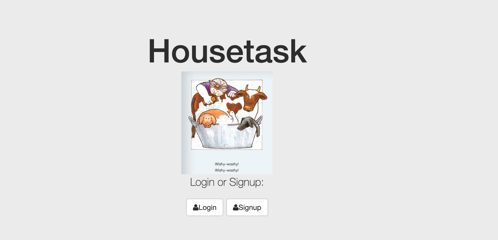
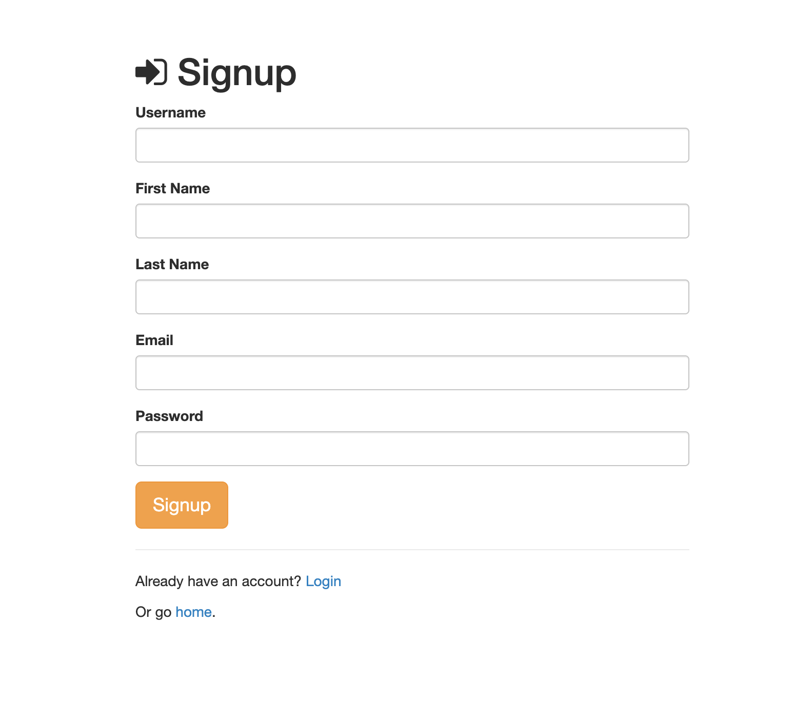
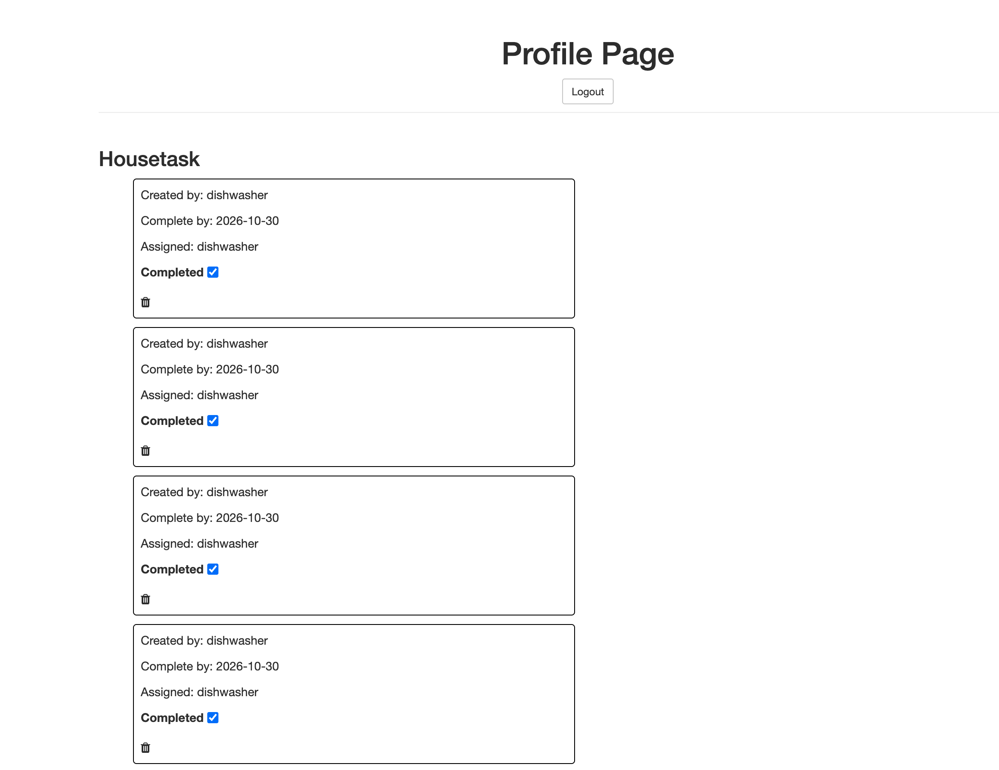

# Housetask

Housetask is a web app that helps people who live under the same roof divide up housework fairly. Add household tasks, claim the ones you'll do, and mark them done when finished.

## Demo

Live: [https://housetask-uqex.onrender.com/](https://housetask-uqex.onrender.com/)

> The app runs on a free Render instance, so the first load may take about a minute.





## Features

- Sign up and log in with a local account
- Add tasks that need to be completed around the house
- Choose which tasks you want to take on
- Mark tasks as done once completed

## Built With

- Node.js and Express
- MongoDB with Mongoose
- Passport.js (authentication)
- EJS templates
- Plain JavaScript and CSS

## Installation

1. Clone the repo
   ```bash
   git clone https://github.com/sabrinalindev/housetask.git
   cd housetask
   ```
2. Install dependencies
   ```bash
   npm install
   ```
3. Create a `.env` file in the project root with your MongoDB connection string
   ```
   DB_STRING=mongodb+srv://<username>:<password>@cluster0.xxxx.mongodb.net/dbname?retryWrites=true&w=majority
   ```

## Usage

1. Start the server
   ```bash
   node server.js
   ```
2. Open `http://localhost:8080` in your browser

## Deployment

Deployed on [Render](https://render.com) as a Web Service:

- Build command: `npm install`
- Start command: `node server.js`
- Environment variable: `DB_STRING` (your MongoDB Atlas connection string)

## Credit

Modified from Scotch.io's authentication tutorial.

## License

Distributed under the MIT License. See `LICENSE` for details.
